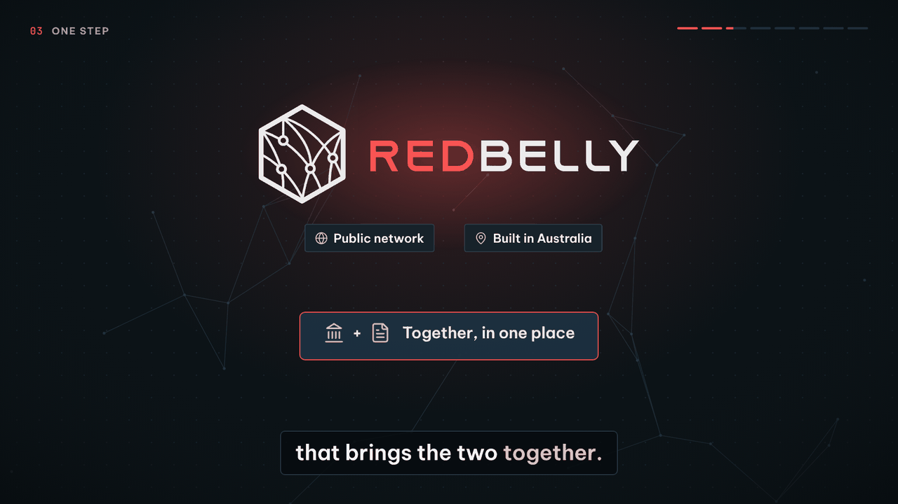
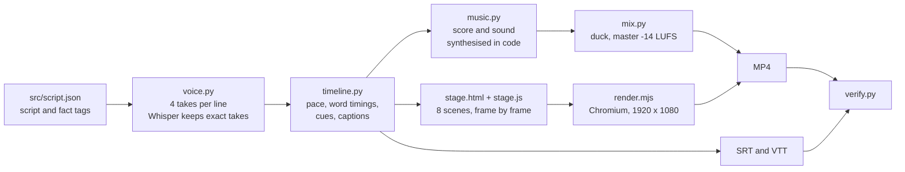

# Redbelly in Simple Terms

[](submission/redbelly-in-simple-terms.mp4)

A 88 second video that explains what Redbelly does and why it matters, in everyday language, for someone who has never touched crypto. It is an entry for the Redbelly DAO Community Task Board task that asks for Redbelly to be explained to a friend, a parent or a business owner, without the one technical word the task rules out.

**Watch:** [`submission/redbelly-in-simple-terms.mp4`](submission/redbelly-in-simple-terms.mp4) &nbsp; **Read:** [`submission/redbelly-in-simple-terms-submission.pdf`](submission/redbelly-in-simple-terms-submission.pdf) &nbsp; **Browse:** [`site/index.html`](site/index.html)

> **Before judging.** The brief fails any entry that is posted publicly before the DAO announces the result. Keep this repository private, and leave GitHub Pages off, until judging is complete.

## The idea

The video opens with a question anyone has felt. A photo crosses the world in a second, so why does buying into a fund still take two business days to settle? Because the money and the record of who owns what sit in different places, and different firms keep their own copies. Redbelly brings the two together. Everything after that is three ideas, and the close repeats them:

| | Idea | In the video |
|---|---|---|
| 1 | **Verified people** | Everyone trading has proved who they are, a bit like showing ID at a bank, and their private details stay protected. |
| 2 | **Rules built in** | Before a trade goes through, the system checks the buyer is allowed to buy it. If not, it simply does not happen. |
| 3 | **Done in one step** | Payment and ownership move together. If either side fails, nothing moves. Once it is done, it is final. |

It then names the idea (tokenisation), shows what it is used for (property, loans, bonds and investment funds), and ends on where Redbelly comes from: research at the University of Sydney and CSIRO, and its place as one of three platforms that carried the Reserve Bank of Australia's pilot digital money in Project Acacia.

## Deliverables

Everything the brief asks for is in [`submission/`](submission).

| Required by the brief | File | Notes |
|---|---|---|
| One entry: a video of up to 90 seconds, 1080p or higher, MP4 | [`redbelly-in-simple-terms.mp4`](submission/redbelly-in-simple-terms.mp4) | 88 s, 1920 x 1080, 60 fps, H.264 and AAC, 15.9 MB, mastered to -14 LUFS |
| Subtitles, burned in or as a separate file | Burned in, and [`.srt`](submission/redbelly-in-simple-terms.srt) + [`.vtt`](submission/redbelly-in-simple-terms.vtt) | Both. The SRT is the format X accepts for uploaded captions |
| A short list of the sources used for any facts | [`sources.md`](submission/sources.md) | 12 public sources, every quote copied from the page |

Also included, to make the entry easy to judge and to reuse:

| File | What it is |
|---|---|
| [`redbelly-in-simple-terms-submission.pdf`](submission/redbelly-in-simple-terms-submission.pdf) | Submission document: the entry, script, storyboard, fact check, checks and production notes |
| [`site/index.html`](site/index.html) | Companion website with the player, script, storyboard and fact check |
| [`transcript.txt`](submission/transcript.txt) | The narration as plain text |
| [`verification-report.md`](submission/verification-report.md) | Output of the automated checks |

## The script

215 words, read at an easy pace. Every line is tagged with the facts it relies on in [`src/script.json`](src/script.json).

> You can send a photo around the world in a second. So why can buying into a fund still take two business days to settle?
>
> Because the money sits in one place, and the record of who owns what sits in another. Different firms keep their own copies, and someone has to check they match.
>
> Redbelly is a public network, built in Australia, that brings the two together. Payment and ownership move in one step. If either side fails, nothing moves. Once it's done, it's final.
>
> And it's not a free-for-all. The people trading are verified, a bit like showing ID at a bank, and their private details stay protected.
>
> The rules are built in too. Before a trade goes through, the system checks the buyer is allowed to buy it. If not, it simply doesn't happen.
>
> So things like property, loans, bonds and investment funds can be issued and traded digitally, and settle almost instantly. People call this tokenisation.
>
> Redbelly grew out of research at the University of Sydney and CSIRO, Australia's national science agency. And when the Reserve Bank of Australia trialled a pilot digital form of its own money, in Project Acacia, Redbelly was one of three platforms that carried it.
>
> Verified people. Rules built in. Done in one step. That's Redbelly.

## Facts

Every statement about Redbelly is backed by Redbelly's own public material or by the Reserve Bank of Australia. The full fact sheet, with quotes, is in [`src/facts.json`](src/facts.json) and [`submission/sources.md`](submission/sources.md). Facts last verified 30 October 2026.

| | Said in the video | Source |
|---|---|---|
| F04 | Redbelly is a public network | Tokeniser, Our Technology; RBA Project Acacia final report, p. 12 |
| F05 | Built in Australia, grew out of research at the University of Sydney and CSIRO | Redbelly Project Acacia page; Tokeniser; Redbelly About Us |
| F06 | Brings the money and the ownership records together | Redbelly, Acacia pilot release (Dec 2025); Redbelly home page |
| F07 | Payment and ownership move in one step; if either side fails, nothing moves | Tokeniser, Instant settlement |
| F08 | Once it's done, it's final | Redbelly, Asset Tokenisation; Tokeniser, Our Technology |
| F09 | The people trading are verified | Redbelly home page; Redbelly, Asset Tokenisation; Tokeniser |
| F10 | Their private details stay protected | Redbelly Project Acacia page; Redbelly blog |
| F11 | Rules built in: eligibility checked before every trade | Redbelly, Asset Tokenisation; Tokeniser, Automated compliance |
| F12 | Property, loans, bonds and investment funds can be issued and traded digitally | Redbelly home page; RBA Project Acacia final report, p. 61 |
| F13 | They settle almost instantly | Tokeniser, Our Technology and Instant settlement |
| F14 | People call this tokenisation | Redbelly, Asset Tokenisation; Acacia pilot release |
| F15 | The Reserve Bank of Australia trialled a pilot digital form of its own money in Project Acacia | RBA media release 2026-13; RBA final report, p. 13 |
| F16 | Redbelly was one of three platforms that carried it | RBA Project Acacia final report, p. 13 |

F01 to F03 are everyday context (a photo in a second, two business days to settle a fund, separate records that must be reconciled); F02 and F03 are sourced too.

## How it meets the brief

| Failure criterion | Status | How |
|---|---|---|
| The banned word, or a stand-in, anywhere in the entry | Clear | Scanned automatically in the narration, captions, every piece of on-screen text, the site, the PDF and every file in this repository |
| Any factual error about Redbelly | Clear | 16 facts, each with quotes from public Redbelly, Tokeniser or RBA material; `--online` re-fetches every source and finds every quote |
| Entry posted publicly before judging | Clear | Not posted anywhere. Keep the repository private until the result |
| Price talk, investment advice or promises of returns | Clear | None in the script; scanned automatically |
| Unlicensed music, images or footage | Clear | No stock media. Music, sound and animation are made in code; fonts, icons and logos are licensed, see [`CREDITS.md`](CREDITS.md) |
| AI generated text submitted without checking | Clear | Every line checked against the fact sheet; the final audio is transcribed and compared word for word with the script |
| Personal credit inside the deliverable | Clear | No names, handles, signatures, watermarks or made-by lines in the video, captions, site or PDF |

The quality benchmarks:

- **Understood by someone with no crypto knowledge after one watch.** One everyday comparison opens the video and everything after it answers the question it raises. The video avoids the usual jargon entirely, and the checker scans for it.
- **Original, memorable and easy to share.** Three short ideas, repeated at the close as the line to remember. Captions are burned in for sound-off viewing on X.
- **Every fact about Redbelly is correct.** Each one is traceable to a quote, with a dated "last verified" line in the video itself, as the DAO brand kit asks for graphics that carry facts.

## Verify it yourself

```bash
python src/checks/verify.py
```

```bash
python src/checks/verify.py --online --asr
```

The first command runs the offline checks: language rules on the entry and the whole repository, fact sheet coverage, file list, video specification, captions against the script, loudness. `--online` fetches every source and confirms each quote is on the page. `--asr` transcribes the finished video with Whisper and confirms the voice says every word of the script and nothing else. Last result: 85 of 85 checks pass, see [`submission/verification-report.md`](submission/verification-report.md).

## How it was made



- **Voice.** Chatterbox Turbo by Resemble AI, open weights under the MIT licence, with its built-in voice. Four takes per line; each is transcribed with Whisper and only takes that match the script word for word can be chosen. The chosen takes are slowed by 5 percent with Rubber Band, formants preserved, for an easy pace.
- **Music and sound.** An original score at 96 BPM, synthesised from oscillators and noise in [`src/audio/music.py`](src/audio/music.py), with the groove landing on the Redbelly reveal. The sound effects are made the same way. The music ducks under the voice.
- **Picture.** Eight HTML and SVG scenes in [`src/video/`](src/video), styled with the DAO Task Board tokens. Each frame is a pure function of time, so frames render in parallel and always match the audio. Every animation and sound effect is anchored to the word that triggers it.
- **Brand.** Follows the [Redbelly DAO Task Board brand kit](https://taskboard.redbellydao.network/brand): slate surfaces, one red accent (`#EF5350`), Be Vietnam Pro for words, JetBrains Mono only for machine values, status shown as a dot plus a mono label, and the voice rules (no em or en dashes, no emoji, no filler verbs), which the checker enforces. The Redbelly logo is used unaltered from the [official brand kit](https://redbelly.network/brand).

## Rebuild from source

Requirements: Python 3.12 or newer, Node 18 or newer with Playwright and Chromium, and ffmpeg built with librubberband.

```bash
pip install torch==2.6.0 torchaudio==2.6.0 --index-url https://download.pytorch.org/whl/cpu
```

```bash
pip install -r requirements.txt
```

```bash
bash src/build.sh --voice
```

`bash src/build.sh` without `--voice` reuses the chosen takes in `build/voice/` and rebuilds everything else: timeline, music, mix, picture, encode, captions, site, PDF and checks. Generating the voice takes about an hour on a 4 core CPU; rendering and encoding the picture takes about 8 minutes.

## Repository layout

```text
submission/            the deliverables: video, captions, sources, PDF, transcript, check report
site/                  companion website (open site/index.html)
src/script.json        the narration, caption breaks and the facts each line uses
src/facts.json         the fact sheet: every claim, source and quote
src/audio/             voice generation, music and sound synthesis, mix and master
src/video/             the eight scenes, the frame renderer
src/docs/              website and PDF builders
src/checks/verify.py   the checks against the brief
src/timeline.py        word timings, cues and captions shared by sound and picture
src/build.sh           one command to rebuild every deliverable
assets/                brand kits, fonts and icons, each with its licence
CREDITS.md             every third-party element and its licence
```
